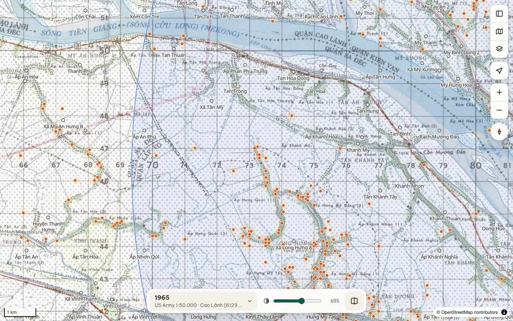
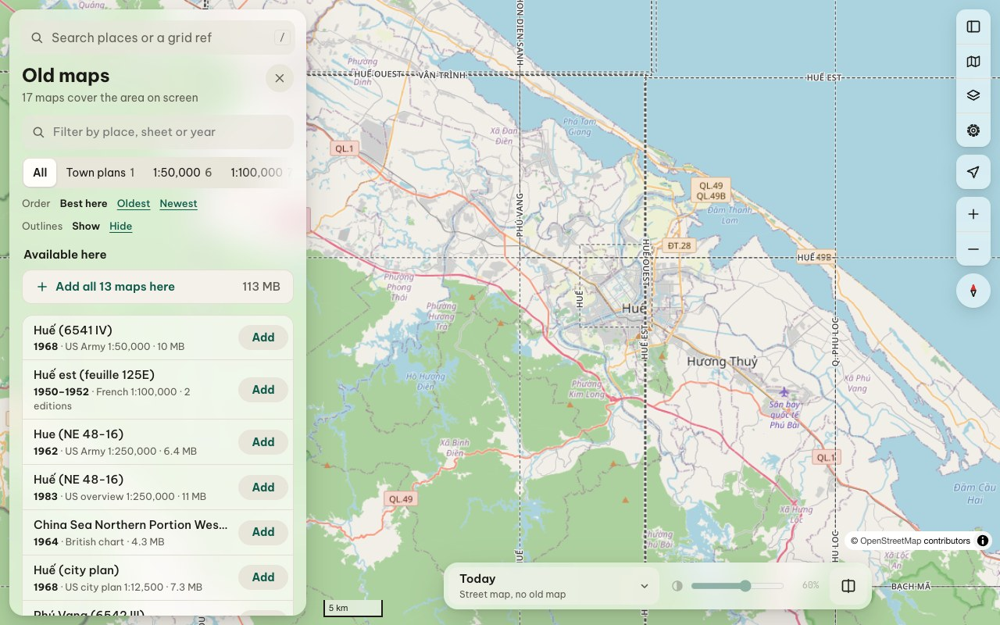

# Map Vietnam

[](https://github.com/CaullenOmdahl/map-vietnam/actions/workflows/ci.yml)
[](LICENSE)
[](https://www.python.org/downloads/)

Old maps of Vietnam on top of today's map, with war-era records you can search and pin. It runs
on your own computer and you use it in your browser.



## Features

- Dated old maps, the earliest from 1873, faded over today's street map or satellite view
- More than 500 maps covering nearly all of Vietnam. You add the ones you want and nothing else
  is downloaded
- Swipe between any two maps side by side
- Search by place name or by a wartime grid reference such as `WS683427`
- Public war-era records: air strikes, aircraft losses, casualty records, hamlets, bases, battles
- Every record shows the coordinate as its source wrote it, how far off it could be, and a link
  to the source
- Collect records and your own pins into a case and export it as GeoJSON, KML or GPX
- Your searches, pins and notes stay on your computer

## Install

You need Python 3.12 or newer, free from [python.org/downloads](https://www.python.org/downloads/).
On a Mac you also need macOS 15 or newer.

1. Download this project. On GitHub that's the green **Code** button, then **Download ZIP**, then
   unzip it. Or `git clone` it if you use git.
2. On a Mac, open the folder and double-click **Start Map Vietnam.command**. On anything else,
   open a terminal in the folder and run:

   ```sh
   python3 start.py
   ```

   On Windows it's `python start.py`.

The first run tells you what it's about to download and waits for a yes. Expect about 120 MB of
public records and 20 to 40 minutes, most of which you can spend elsewhere. If it stops partway,
run it again and it picks up where it left off. When it's done the map opens in your browser.
Keep the terminal window open while you use it. Control-C stops it.

The first time, macOS may refuse to open the `.command` file because it came from the internet.
Right-click it, choose **Open**, then **Open** again.

If something goes wrong, see [docs/troubleshooting.md](docs/troubleshooting.md).

## Usage

Setup doesn't download any old maps. There are more than 500 of them and you probably want six.

Go to the place you care about and click **Add old maps** at the bottom of the screen. You get
every map that covers what's on screen, with its size, and outlines showing where each one sits.
Click **Add** on the ones you want. A map takes about a minute and about 20 MB.



The bar at the bottom switches between the maps you've added, and its slider fades the old map in
and out. The button at the right end splits the screen so you can drag between two maps. This is
Cao Lãnh in 1873 and in 1965:


The [user guide](docs/guide.md) has the rest: removing maps, doing it all from a terminal, grid
references, cases and exports, and the optional air-strike records, which need a free Kaggle key.

## Data sources

None of the data is in this repository. Records are downloaded from their publishers during
setup, and each old map when you add it.

The maps are US Army 1:50,000 and 1:250,000 sheets from the USGS store, which are public domain,
and older French and US scans from five map libraries. The records come from the US National
Archives, the NGA place-name server, Wikipedia, Wikidata and OpenStreetMap. Two more sources are
optional: US Air Force strike records from Kaggle, and helicopter losses from the Vietnam
Helicopter Pilots Association website.

[docs/data-sources.md](docs/data-sources.md) goes through each one, and [NOTICE](NOTICE) has the
licences and credits.

## Accuracy and limits

Old maps don't sit perfectly on new ones. The 1960s US sheets are within about 50 m and the
1:250,000 sheets within 100 to 200 m. The older French maps can be out by hundreds of metres.

Wartime grid references were read off maps drawn on the Indian 1960 datum, a few hundred metres
from the grid a GPS uses. Map Vietnam assumes Indian 1960 for any grid reference you type and
shows the GPS equivalent beside it.

Every record carries a ring showing how well its source pins it down, and sources are sometimes
plainly wrong. Read the original before you rely on a record.
[docs/known-limits.md](docs/known-limits.md) lists the problems found so far.

Air-strike sites can still hold unexploded ordnance. Don't visit one without clearance from the
local authorities.

## Privacy

The map is served to your own machine only (`127.0.0.1`). Your cases, notes and searches are
never sent anywhere. The page does load background map tiles, the MapLibre library and fonts
from the internet, so those sites see your IP address, as any website you visit does.
[docs/guide.md](docs/guide.md#what-goes-over-the-internet) names them.

## Documentation

- [User guide](docs/guide.md)
- [Troubleshooting](docs/troubleshooting.md)
- [Data sources](docs/data-sources.md)
- [Known limits](docs/known-limits.md)
- [How it works](docs/how-it-works.md)
- [Changelog](CHANGELOG.md)

## Contributing

Corrections to records, new maps, new sources and fixes are all welcome.
[CONTRIBUTING.md](CONTRIBUTING.md) says how to set up, where things are, and what a change needs
before it's merged. To report a security problem, see [SECURITY.md](SECURITY.md).

## Licence

The code is under the [Apache License 2.0](LICENSE). The maps and records it downloads aren't
part of this repository and keep their own licences.
