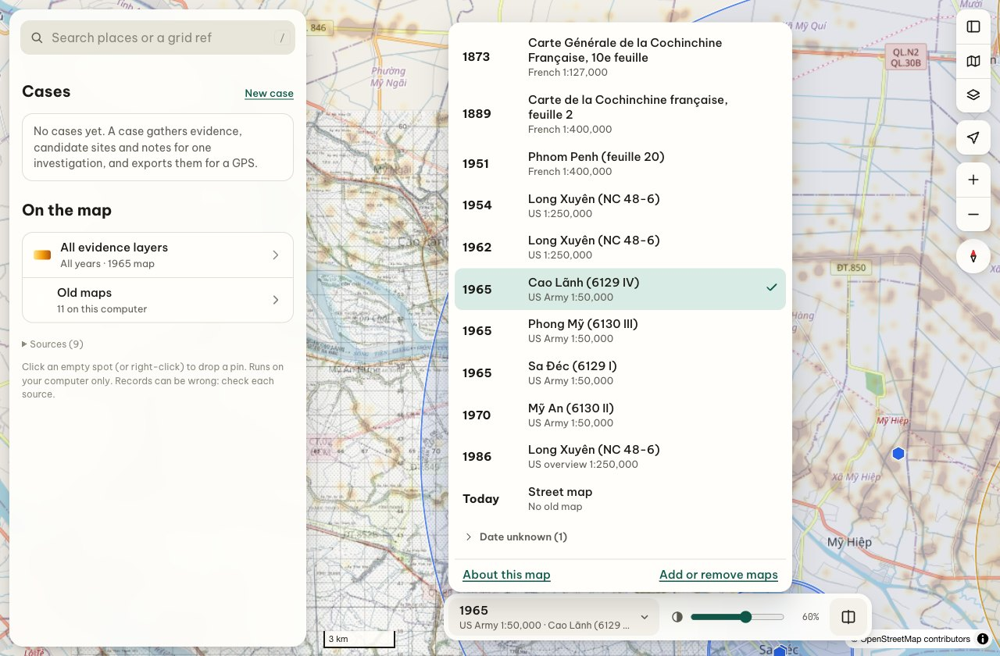
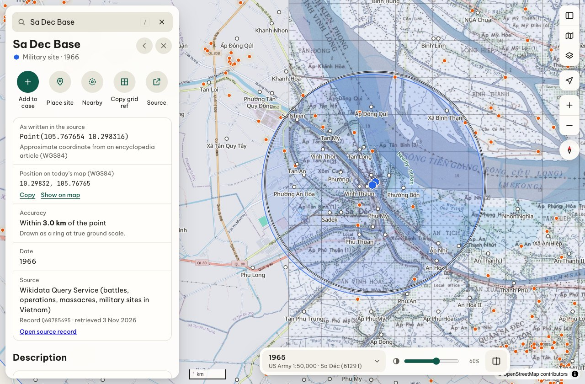

# Map Vietnam

Old maps of Vietnam on top of today's map, along with the war-era records that came with
coordinates: air strikes, aircraft losses, casualties, hamlets, bases. It runs on your own
computer and you use it in your browser.


Go to a place, add an old map of it, and fade between then and now. The maps run from an 1873
French chart to the US Army sheets of the 1960s. Click a record and you get the coordinate as the
source wrote it, where that falls today, how far off it could be, and a link back to the source.

## Getting it running

You need Python 3.12 or newer, free from [python.org/downloads](https://www.python.org/downloads/).
If you're not sure what you have, type `python3 --version` in a terminal. On a Mac you also need
macOS 15 or newer.

1. Download this project. On GitHub that's the green **Code** button, then **Download ZIP**, then
   unzip it. Or `git clone` it if you use git.
2. On a Mac, open the folder and double-click **Start Map Vietnam.command**. On anything else,
   open a terminal in the folder and run:

   ```sh
   python3 start.py
   ```

   On Windows it's `python start.py`.

The first run tells you what it's about to download and waits for a yes. Expect about 120 MB of
public records and 20 to 40 minutes, most of which you can spend elsewhere. If it stops partway,
run it again and it picks up where it left off. When it's done the map opens in your browser.
Keep the terminal window open while you use it. Control-C stops it.

The first time, macOS may refuse to open the `.command` file because it came from the internet.
Right-click it, choose **Open**, then **Open** again.

## Adding old maps

Setup doesn't download any old maps. There are more than 500 of them, the full set is over 11 GB,
and you probably want six.

Go to the place you care about and click **Add old maps** at the bottom of the screen. You get
every map that covers what's on screen, with its size, and outlines on the map showing where each
one sits. Click **Add** on the ones you want. A map takes about a minute and appears on its own
when it's ready.


A detailed US Army sheet (1:50,000, roughly 27 km on a side) takes about 20 MB on disk. To get
rid of a map, click it in the same list and choose **Remove**.

You can do the same from a terminal:

```sh
python3 start.py maps list --area 105.4,10.2,105.9,10.6   # west,south,east,north
python3 start.py maps add L701461294
python3 start.py maps add --area 105.4,10.2,105.9,10.6
python3 start.py maps remove L701461294
```

`maps add` shows the count and download size and asks before it starts.
`python3 start.py maps --help` has the rest.

## Finding your way around

The bar at the bottom names the old map that's showing. Click it to switch to another, or pick
**Today** to turn old maps off. The slider next to it fades the old map in and out.



The button at the right end of the bar splits the screen so you can drag between two maps. Below
is Cao Lãnh in 1873 and in 1965. The river didn't move that far. The 1873 survey was just that
rough.


The search box takes place names, with or without Vietnamese accents, and grid references copied
from wartime reports, like `WS683427`. A grid reference names a square rather than a point, so a
square is what gets drawn.


Click any record to open its card. The ring around it on the map is how far off the position
could be. Records you want to keep go into a case, which is a named collection of records, places
and notes. A case exports to GeoJSON, KML or GPX, for a GPS or Google Earth.



In a narrow window the side panel turns into a sheet you drag up from the bottom, the way a
phone map app does it.


## Air strikes need a Kaggle key

The US Air Force strike records (THOR) are hosted on Kaggle, which wants a free account before it
lets you download anything. Everything else works without one.

1. Sign in or register at [kaggle.com](https://www.kaggle.com).
2. Click your picture at the top right, then **Settings**.
3. Under **API**, click **Create Legacy API Key**. Older versions of the page call it **Create New
   Token**. Your browser downloads a file called `kaggle.json` with a username and a key in it.
4. Run `python3 start.py setup --only thor` and paste the two values in when it asks.

If you'd rather not paste, copy `.env.example` to `.env` and fill in the two lines, or put
`kaggle.json` in a `.kaggle` folder in your home folder. Whichever you pick, the key stays on
your computer. The download is about 320 MB, and only the strikes around Cao Lãnh are loaded
unless you ask for more. [docs/data-sources.md](docs/data-sources.md) says how.

Helicopter losses are off by default too. They come from the Vietnam Helicopter Pilots
Association website, which is copyrighted, so Map Vietnam keeps only short facts from it, for
personal research. It also reads the site slowly so as not to be a nuisance: one page every
three seconds, about four hours in all. Turn it on with `python3 start.py setup --only vhpa`.

## Where the data comes from

None of it is in this repository. Records are downloaded from their publishers during setup, and
each old map when you add it.

| Source | What it is | Licence | Key needed? |
| --- | --- | --- | --- |
| US Army Map Service L7014, L7015, L7016 (USGS store) | 1:50,000 map sheets, mostly 1965–1970 | US Government work, public domain | No |
| Joint Operations Graphic 1501 (USGS store) | 1:250,000 map sheets, about 1966–2000 | US Government work, public domain | No |
| Older scanned maps (five map libraries) | French and US maps, 1873–1962 | Varies by holder, see [NOTICE](NOTICE) | No |
| NGA GEOnet Names Server | Place names of Vietnam, with old spellings | US Government work | No |
| US National Archives: HES gazetteers | Wartime hamlet list with grid references | Public domain | No |
| US National Archives: CACCF | US casualty records, body not recovered | Public domain | No |
| Wikipedia (English) | List of US personnel missing in action | CC BY-SA 4.0 | No |
| Wikipedia (Vietnamese) | Vietnam's listed national historic sites | CC BY-SA 4.0 | No |
| Wikidata | Battles, bases, crash sites | CC0 | No |
| OpenStreetMap | Historic military places, memorials, borders | ODbL 1.0 | No |
| THOR (Kaggle) | US air strikes, 1965–1973 | Public domain / CC0 | Free Kaggle key |
| VHPA (optional) | Helicopter losses | Copyrighted; facts only, personal research | No |

[docs/data-sources.md](docs/data-sources.md) goes through each source: what it holds, how it gets
placed on the map, and its licence in full.

## Before you trust a dot on the map

Old maps don't sit perfectly on new ones. The 1960s US sheets are within about 50 m, and the
1:250,000 overview sheets within 100 to 200 m. The older French maps can be out by hundreds of
metres, and in places by a few kilometres. Each map's "About this map" card gives its own figure.

Wartime grid references were read off maps drawn on the Indian 1960 datum, which sits a few
hundred metres from the grid a GPS uses. Map Vietnam assumes Indian 1960 for any grid reference
you type, and shows the GPS equivalent beside it.

Every record carries a ring showing how well its source pins it down. Something placed only by
province gets a ring tens of kilometres wide. Sources are also sometimes plainly wrong, so read
the original before you rely on a record. [docs/known-limits.md](docs/known-limits.md) lists the
problems found so far.

Some border areas and islands have no 1:50,000 sheet in the archive. The 1:250,000 sheets cover
most of them, and [docs/data-sources.md](docs/data-sources.md#coverage) lists what's left.

Air-strike sites can still hold unexploded ordnance. Don't visit one without clearance from the
local authorities.

## Privacy

The map is served to your own machine only (`127.0.0.1`), so nobody else on your network can
open it. Your cases and notes live in `data/evidence.sqlite`, and they are never sent anywhere.
Neither are your searches.

The page does load a few things from the internet while you use it: background tiles for today's
map (OpenStreetMap and Esri), the MapLibre map library (unpkg.com), and fonts (Google Fonts, and
Protomaps on GitHub). Those sites see your IP address, as any website you visit does.

## When something goes wrong

"Port 8765 is in use." Map Vietnam takes the next free port and prints the address to open. To
choose one yourself, run `python3 start.py serve --port 9000`.

"Map Vietnam needs Python … or newer." Install the latest Python from
[python.org/downloads](https://www.python.org/downloads/) and start again.

"Installing the Python add-ons failed." Check your internet connection and start again. On a Mac
older than macOS 15 the map tools won't install, so update macOS first.

A download failed. The archives are sometimes busy, OpenStreetMap's Overpass servers most of
all. The summary at the end says what failed, and running `python3 start.py` again later redoes
only that. The full log for each part is in `data/work/setup/logs/`.

Kaggle says the key is wrong. Make a new key, then run `python3 start.py setup --only thor`
again, or correct the two lines in `.env`.

The map is blank. Open the address `start.py` prints (normally `http://127.0.0.1:8765/app/`),
not the HTML file itself.

## Working on the code

`python3 start.py setup` makes `.venv/` and installs the dependencies. After that:

```sh
.venv/bin/python -m pip install ruff
.venv/bin/python -m pytest -q
.venv/bin/ruff check .
.venv/bin/ruff format --check .
```

[CONTRIBUTING.md](CONTRIBUTING.md) has the file layout and how to add a record source or a map.
[docs/how-it-works.md](docs/how-it-works.md) covers the design, the record format and the map
pipeline.

## Licence

The code is under the [Apache License 2.0](LICENSE). The maps and records it downloads aren't
part of this repository and keep their own licences. [NOTICE](NOTICE) gives each source's terms
and the credit it asks for.
