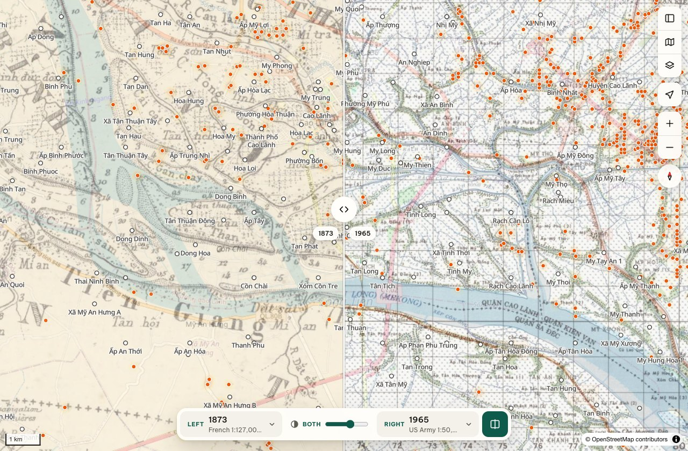
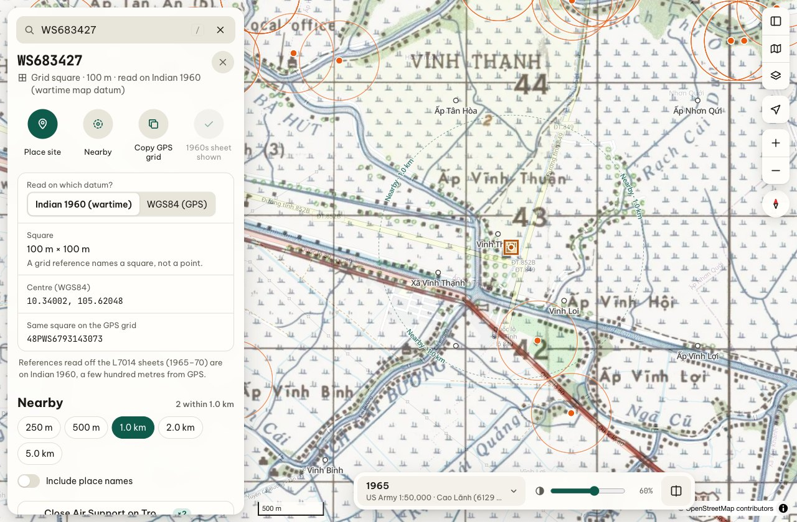
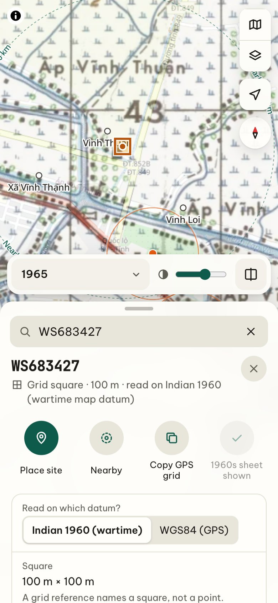

# Map Vietnam

Old maps of Vietnam laid over today's map, with war-era records you can search, filter, pin and export.


*A 1965 US Army 1:50,000 sheet south of Cao Lãnh over today's street map, at the 60% a first
visit starts with. Drag the slider to see more or less of the old map.*

## What is this?

Map Vietnam is a research tool that runs on your own computer. It shows dated maps of Vietnam,
from 1873 to 1970, on top of a modern map, so you can see how places, roads and rivers have
changed. Over the maps it puts war-era public records: air strikes, aircraft losses, casualty
records, wartime place names, battles and historic sites. You can look any of them up, see where
the source says it was and how sure that position is, and export what you find.

## Try it in 3 steps

**1. Install Python.** Map Vietnam needs Python 3.12 or newer. Get it free from
[python.org/downloads](https://www.python.org/downloads/) and run the installer. To check which
version you have, open Terminal (on a Mac: Applications, then Utilities) and type:

```sh
python3 --version
```

It should say `Python 3.12` or a higher number. On a Mac you also need macOS 15 (Sequoia) or
newer, because one of the map tools is only published for it.

**2. Download Map Vietnam.** On the project's GitHub page, click the green **Code** button, then
**Download ZIP**, and double-click the ZIP to unpack it. Or, if you use git, copy the address
shown under the **Code** button and run:

```sh
git clone <the address you copied>
cd map-vietnam
```

**3. Start it.** On a Mac, open the folder and double-click **Start Map Vietnam.command**. The
first time, macOS may say it cannot check the file; if so, right-click it, choose **Open**, then
**Open** again. On any computer you can instead open a terminal in the folder and type:

```sh
python3 start.py
```

The first run explains what it will download and asks before it starts. It fetches about 120 MB
of public records (about 320 MB more if you add the optional air-strike records, below) and needs
about 1 GB of disk space. It usually takes 20 to 40 minutes, so you can leave it running. If you
stop it, or something fails, run it again: it carries on where it left off.

No old map is downloaded during setup. You choose the ones you want once the map is open (see
"Add old maps" below), and you can remove any of them again.

When it is ready, the map opens in your web browser. Leave the Terminal window open while you use
it; close it (or press Control-C) to stop. Later starts skip everything already done and open the
map within seconds.

## Using it

### It opens on today's map

The first time, you see an ordinary street map of Vietnam with the war-era records on it. There
are no old maps yet: nothing was downloaded during setup. You pick the old maps you want, for the
places you care about, and only those are downloaded.

### Add old maps

1. Move and zoom the map to the place you want to look at.
2. Click **Add old maps** in the bar at the bottom of the screen. (Once you have some old maps,
   the same list is under **Old maps** in the side panel, and **Add or remove maps** in the map
   picker.)
3. A list opens with every old map that covers what is on your screen, and its size. Outlines on
   the map show where each one lies. Click **Add** next to the ones you want.

Each map downloads from its public archive and is ready about a minute later. You do not have to
wait on the card: the bar at the bottom shows how far it has got, and the map appears by itself
when it is done.


*The Old maps list around Huế. Each dashed outline on the map is one sheet you can add, labelled
along its edge. The switch at the top shows all maps, or only the detailed 1:50,000 sheets, the
1:250,000 overview sheets or the older scans.*

**How much space they take.** One detailed US Army sheet (1:50,000, about 27 by 27 km) is about
10 MB to download and takes about 20 MB on your computer (its tiles, plus the downloaded file,
which is kept so the map can be rebuilt without downloading it again). All 498 of them, the whole
country, are about 5 GB to download and about 11 GB on disk. Most people only need the handful
around the places they are researching. The list shows the size of each map before you add it.

### Remove old maps

Open **Old maps**, click the map you no longer want, then **Remove**, and confirm. Its tiles and
its download are deleted, and you can add it again later.

### Do the same from a terminal

Everything in the Old maps list can also be done by typing commands in the Map Vietnam folder
(on Windows, type `python` instead of `python3`):

```sh
python3 start.py maps list --area 105.4,10.2,105.9,10.6   # maps of an area (west,south,east,north)
python3 start.py maps list --region south                 # maps of the north, centre or south
python3 start.py maps list --installed                    # the maps you have added
python3 start.py maps add L701461294                      # add one map by its id (asks first)
python3 start.py maps add --area 105.4,10.2,105.9,10.6    # add every map touching that area
python3 start.py maps remove L701461294                   # remove one map
python3 start.py maps remove --all                        # remove every map you added
```

`maps add` always shows the number of maps and the download size, and asks before it starts.

### Choose which old map is shown

The bar at the bottom shows which old map is on. Click it to pick another, oldest first;
**Today** turns the old maps off. The slider next to it sets how see-through the old map is (60%
the first time; drag it right to see more of the old map).


*The map picker, with the maps added around Cao Lãnh. Each shows its date, title and scale.*

### Swipe between two maps

The button at the right of the bar splits the screen. Drag the handle in the middle to wipe
between the left and the right map.



*Cao Lãnh on the 1873 French chart of Cochinchina (left) and the 1965 US sheet (right). The 1873
survey puts the river and the town some way from where later maps do; old maps are only as exact
as the surveys behind them.*

### Search for a place or a wartime grid reference

Type a place name (with or without Vietnamese accents), a record, or a grid reference copied from
a wartime report, such as `WS683427`. A grid reference names a square, not a point, so the map
shows the whole square.



*Grid square WS683427, read on the wartime map datum, with the records near it.*

### Open a record

Click any point on the map or in the search results. The card shows the coordinate exactly as the
source wrote it, where that is on today's map, how accurate it is (drawn as a ring on the map),
the date, and a link back to the original source. From a card you can add the record to a
*case*: a named collection of records, places and notes that you can export for a GPS or Google
Earth (GeoJSON, KML or GPX).


*A record card, over the 1965 Sa Đéc sheet. The blue ring on the map is the 3 km accuracy of
this position.*

### On a phone or a small window

In a narrow window the panel becomes a sheet you drag up and down, like a phone map app.



*On a phone: the old map on top, the panel as a sheet at the bottom.*

## Optional: air-strike records

The US Air Force's THOR air-strike records come from Kaggle, which needs a free account and key.
Without a key everything else works, and the air strikes are left out.

1. Go to [kaggle.com](https://www.kaggle.com) and sign in, or register (it is free).
2. Click your picture (top right), then **Settings**.
3. In the **API** section, under the legacy credentials, click **Create Legacy API Key** (older
   versions of the page call it **Create New Token**). Your browser downloads a file called
   `kaggle.json`.
4. Open `kaggle.json` in a text editor. It holds your `"username"` and `"key"`.

Then do one of these:

- Run `python3 start.py setup --only thor`. It asks for the username and key and saves them.
- Or copy `.env.example` to a new file called `.env` in the same folder, and fill in the
  `KAGGLE_USERNAME=` and `KAGGLE_KEY=` lines.
- Or put `kaggle.json` in a folder called `.kaggle` in your home folder.

The key stays on your computer: `.env` is readable only by you and is never uploaded. The download
is about 320 MB. By default only the strikes around Cao Lãnh are loaded;
[docs/data-sources.md](docs/data-sources.md) says how to load all of Vietnam.

**Helicopter losses (VHPA)** are optional too, and stay off unless you say yes on the first run or
run `python3 start.py setup --only vhpa`. The Vietnam Helicopter Pilots Association website is
copyrighted, so only short facts are kept, for personal research. It is read slowly on purpose,
one page every 3 seconds (about 4,000 pages, 3 to 4 hours), so as not to burden the site.

## Where the data comes from

Nothing is bundled: each record source is downloaded from its publisher the first time you run
Map Vietnam, and each old map when you add it.

| Source | What it is | Licence | Key needed? |
| --- | --- | --- | --- |
| US Army Map Service L7014, L7015, L7016 (USGS store) | 1:50,000 map sheets, mostly 1965–1970 | US Government work, public domain | No |
| Joint Operations Graphic 1501 (USGS store) | 1:250,000 map sheets, about 1966–2000 | US Government work, public domain | No |
| Older scanned maps (five map libraries) | French and US maps, 1873–1962 | Varies by holder, see [NOTICE](NOTICE) | No |
| NGA GEOnet Names Server | Place names of Vietnam, with old spellings | US Government work | No |
| US National Archives: HES gazetteers | Wartime hamlet list with grid references | Public domain | No |
| US National Archives: CACCF | US casualty records, body not recovered | Public domain | No |
| Wikipedia (English) | List of US personnel missing in action | CC BY-SA 4.0 | No |
| Wikipedia (Vietnamese) | Vietnam's listed national historic sites | CC BY-SA 4.0 | No |
| Wikidata | Battles, bases, crash sites | CC0 | No |
| OpenStreetMap | Historic military places, memorials, borders | ODbL 1.0 | No |
| THOR (Kaggle) | US air strikes, 1965–1973 | Public domain / CC0 | Free Kaggle key |
| VHPA (optional) | Helicopter losses | Copyrighted; facts only, personal research | No |

What each source holds, how it is placed on the map, and its licence in full:
[docs/data-sources.md](docs/data-sources.md).

## Good to know

- **Old maps are not perfectly placed.** The 1960s US 1:50,000 sheets line up with today's map
  to within about 50 m, the 1:250,000 overview sheets to about 100–200 m. The older French maps were surveyed with the tools of their day and can be off by
  hundreds of metres, in places a few kilometres. Each map's "About this map" card says how far.
- **A few places have no detailed old map.** Some border areas and islands have no 1:50,000
  sheet in the archive; the 1:250,000 sheets cover most of them.
  [docs/data-sources.md](docs/data-sources.md#coverage) lists the gaps.
- **Wartime grid references use a different datum.** Grid references in wartime reports were
  read off maps drawn on the *Indian 1960* datum, a few hundred metres from the WGS84 grid a GPS
  uses. Map Vietnam reads them on Indian 1960 unless you choose otherwise, and shows the GPS grid
  reference for the same square.
- **Every point has an accuracy ring.** A record never claims to be more precise than its source.
  A record placed only by province has a ring tens of kilometres wide.
- **Records can be wrong.** Read the source before relying on a record.
  [docs/known-limits.md](docs/known-limits.md) lists the problems we know about.
- **Strike sites may hold unexploded ordnance.** Exports say so. Never visit a site without
  clearance from the local authorities.
- **It stays on your computer.** The map is served only to your own machine (`127.0.0.1`), so
  nobody else on your network can open it. Your cases and notes are kept in
  `data/evidence.sqlite`. What it fetches from the internet: the record downloads during
  setup, each old map you add (from its archive), and, while you use the map, the background tiles for today's map (OpenStreetMap
  and Esri), the map library (MapLibre, from unpkg.com), the page fonts (Google Fonts) and the
  map label fonts (Protomaps, on GitHub). Those sites see your IP address, as with any web page;
  your searches, cases and notes are never sent.

## For developers

### Layout

```text
start.py                    one-command setup and server (standard library only)
Start Map Vietnam.command   macOS double-click launcher for start.py
requirements.txt            pinned Python dependencies
scripts/
  library.py                the map library: adds and removes old maps (python3 start.py maps ...)
  map_library_catalogue.py  builds data/sources/map_library.json, every map that can be added
  download_maps.py          fetches one map's file from the addresses in that catalogue
  l7014_meta.py             reads title, date and datum from a US GeoPDF (kept in its map's metadata)
  build_tiles.py            a GeoPDF sheet -> web/tiles/<id>.mbtiles
  georef_scan.py            a scanned map + control points (data/scans/<id>.json) -> web/tiles/<id>.mbtiles
  tiling.py, datums.py      shared tiling (WebP tiles in one MBTiles file per map) and datum code
  catalog.py                web/tiles/ -> web/catalog.json, the viewer's list of installed maps
  gridref.py                wartime MGRS grid references on Indian 1960 or WGS84
  store.py                  the SQLite evidence store, data/evidence.sqlite
  server.py                 local web server and JSON API
  compare_overlay.py        side-by-side image to check how well a map lines up
  ingest/<source>.py        one ingester per record source; common.py holds shared helpers
web/app/                    the viewer: index.html, app.js, app.css (MapLibre GL, no build step)
tests/                      pytest suite; tests/fixtures/ holds small source excerpts
docs/                       how it works, data sources, known limits
```

Downloads go to `data/raw/`, intermediate files to `data/work/`, records to
`data/evidence.sqlite` and the maps a person added to `web/tiles/`. All of these are kept out of
git: `start.py` rebuilds the records, and each map is rebuilt when it is added again.

### Set up, test and lint

`python3 start.py setup` makes `.venv/` and installs `requirements.txt` into it. Then:

```sh
.venv/bin/python -m pip install ruff
.venv/bin/python -m pytest -q
.venv/bin/ruff check .
.venv/bin/ruff format --check .
```

`pytest.ini` puts `scripts/` and `scripts/ingest/` on the import path. CI runs the same checks on
Linux and macOS ([.github/workflows/ci.yml](.github/workflows/ci.yml)).

### How ingesters work

Each source has one ingester, `scripts/ingest/<source>.py`. It downloads the source once into
`data/raw/<source>/` (politely, with a pause between requests), turns each row into a
`store.Evidence` record and writes them with `store.sync_source`. Every record keeps the
coordinate exactly as the source gave it, its datum, the converted WGS84 position and an accuracy
radius in metres. After a sync the store holds exactly what the source now gives: a record that
has disappeared is deleted, unless someone added it to a case, in which case it is kept and marked
withdrawn.

To run or re-run one source (plus anything unfinished that it depends on):

```sh
python3 start.py setup --only gns
```

`python3 start.py --help` lists the part names. [docs/how-it-works.md](docs/how-it-works.md)
describes the record format and the rules every ingester follows.

### Adding a map

Every map that can be added is listed in `data/sources/map_library.json`, which
`scripts/map_library_catalogue.py` generates (do not edit it by hand):

- **US GeoPDF sheets** (1:50,000 and 1:250,000) come from a probe of the USGS store and the PDFs'
  own metadata; see the script's docstring. Each sheet is placed by the georeferencing inside
  its GeoPDF and cut at its frame.
- **A scanned map:** add an entry to the `scans` list in `data/sources/maps.json` (the script copies
  it into the catalogue), write `data/scans/<id>.json` with at least three control points (pixel
  to longitude and latitude) and the map's title, date and source, then regenerate the catalogue.

Then add the map with `python3 start.py maps add <id>`. To rebuild a map that is already added,
remove it and add it again (`python3 start.py maps remove <id>`).
[docs/how-it-works.md](docs/how-it-works.md) explains both pipelines.

### More reading

- [docs/how-it-works.md](docs/how-it-works.md): design, data model and map pipeline
- [docs/data-sources.md](docs/data-sources.md): every source, its licence and how it is placed
- [docs/known-limits.md](docs/known-limits.md): open problems in the records
- [CONTRIBUTING.md](CONTRIBUTING.md): how to contribute

## Troubleshooting

- **"Port 8765 is in use".** Map Vietnam picks the next free port by itself and prints the address
  to open. To choose one yourself: `python3 start.py serve --port 9000`.
- **"Map Vietnam needs Python … or newer".** Install the latest Python from
  [python.org/downloads](https://www.python.org/downloads/), then start again. On a Mac, the
  `.command` file looks for the newest Python you have installed.
- **"Installing the Python add-ons failed".** Check your internet connection and start again. On
  a Mac older than macOS 15 the map tools cannot be installed; update macOS first.
- **A download failed.** Archives are sometimes busy (OpenStreetMap's Overpass servers often
  are). The summary at the end lists what failed. Run `python3 start.py` again later; finished
  parts are not redone. Each part's full log is in `data/work/setup/logs/`.
- **Kaggle says the key is wrong.** Make a new key (see above), then run
  `python3 start.py setup --only thor` and paste it, or correct the two lines in `.env`.
- **The map is blank, or the old maps are missing.** Open the address `start.py` prints (normally
  `http://127.0.0.1:8765/app/`), not the HTML file itself.

## Licence

The code is licensed under the [Apache License 2.0](LICENSE). The maps and records it downloads
are not part of this repository and keep their own licences; [NOTICE](NOTICE) gives each source's
terms and the credit it asks for.
