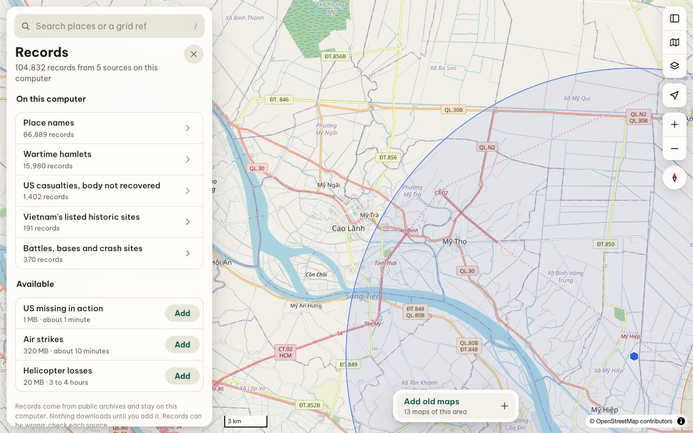
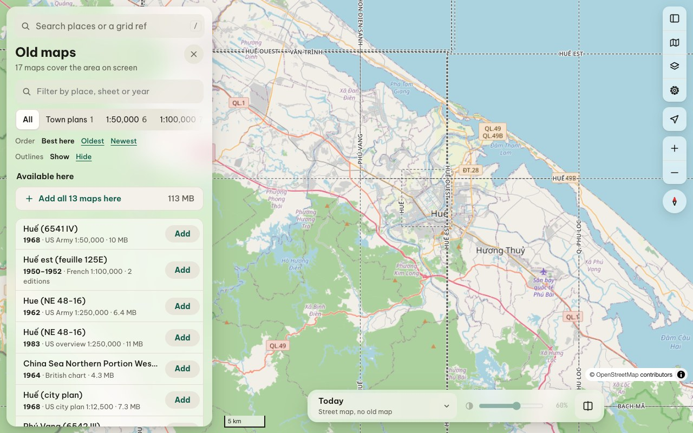
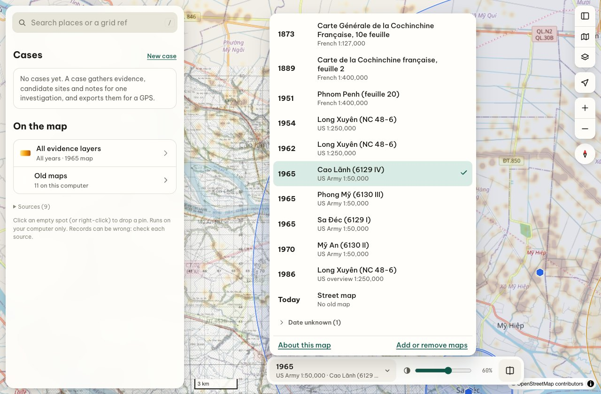
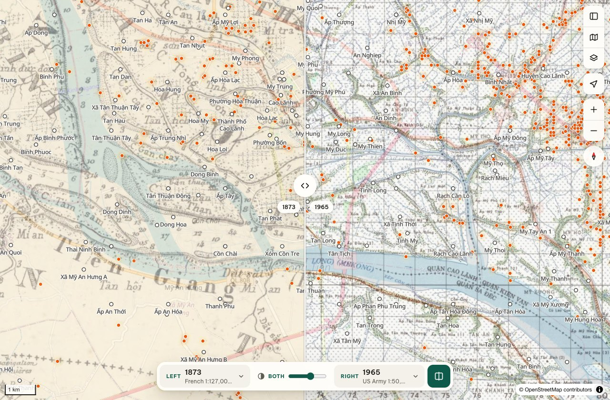
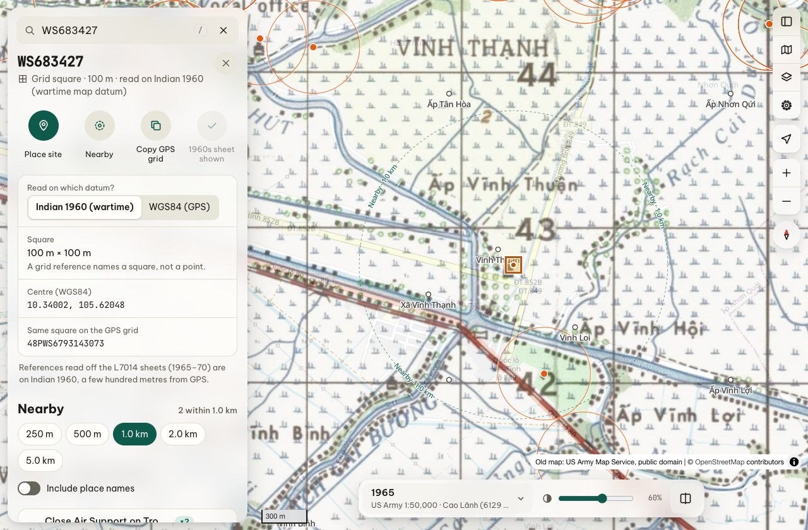
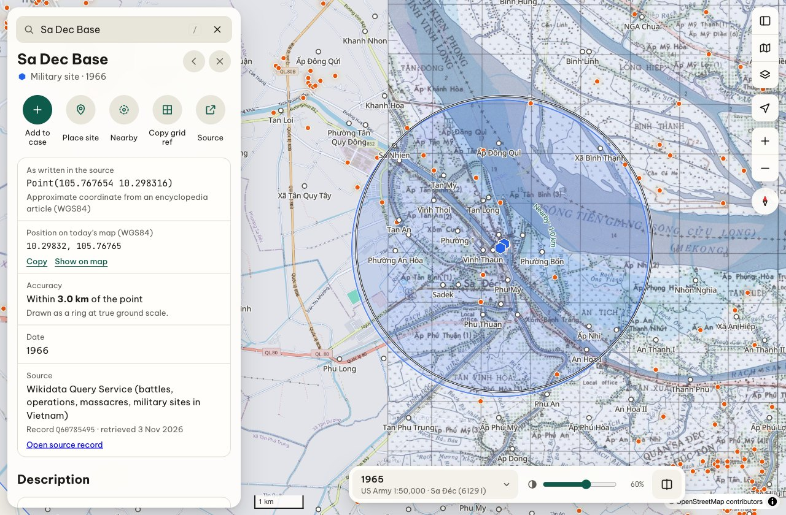
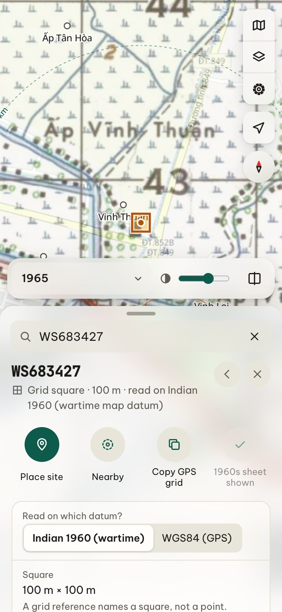

# User guide

How to use Map Vietnam once it's running. To get it running, see the [README](../README.md#install).

## Adding records

Map Vietnam starts empty. The first time it opens, a card in the side panel offers the standard
records: place names, wartime hamlets, bases, battles and casualty records. Click **Add the
standard records**. It's about 70 MB from public archives and takes about 15 minutes. You can
use the map meanwhile, and the records appear on it as each source finishes.



**Records** in the side panel lists every source. Click a source to read what it is, how big it
is and its licence. **Add** downloads it, the ring that replaces the button stops it, and
**Retry** tries again if a download failed. What was already downloaded is kept, so a retry
picks up where it left off.

Two sources aren't in the standard set, because each needs a choice from you.
[Air strikes](#air-strike-records) are added for an area you pick, and
[helicopter losses](#helicopter-losses) take hours.

## Removing records

Open **Records**, click the source, choose **Remove** and confirm. Its records leave the map and
its downloads are deleted. Records you've put in a case stay in the case, marked as withdrawn.
**Update** downloads a source again, for corrections its publisher has made since.

## Adding old maps

No old map is downloaded until you add it. You add the ones you want, for the places you care
about.

Go to a place and click **Add old maps** at the bottom of the screen. Once you have some maps,
the same list is under **Old maps** in the side panel. You get every map that covers what's on
screen, with its size, and outlines on the map showing where each one sits. Click **Add** on the
ones you want. A map takes about a minute and appears on its own when it's ready. You don't have
to wait with the list open, because the bar at the bottom shows progress.



To find a map somewhere else, type a town, a sheet number or a year in the box at the top of the
list ("Huế", "feuille 221", "1952"): it searches every map, not just the ones on screen. The
chips under it narrow the list to one scale, from town plans to 1:250,000, and show how many maps
each has; **Oldest** and **Newest** put the list in date order. When a sheet was printed more than
once, its editions share one row: **Add** takes the newest, and opening the row lists the others.

A detailed US Army sheet (1:50,000, roughly 27 km on a side) is about 10 MB to download and
about 20 MB on disk, because the download is kept so the map can be rebuilt. All 498 of them come
to about 5 GB of downloads and 11 GB on disk.

## Removing maps

Open **Old maps**, click the map, choose **Remove** and confirm. Its tiles and its download are
deleted. You can add it again later.

## Doing it from a terminal

None of this is needed, but everything above can be scripted. Run these in the Map Vietnam
folder. On Windows, type `py` instead of `python3`.

```sh
python3 start.py setup                                    # add the standard records
python3 start.py setup --only thor --area 105.4,10.2,105.9,10.6   # air strikes for an area
python3 start.py setup --only vhpa                        # helicopter losses
python3 start.py records list                             # the sources and what's added
python3 start.py records remove gns                       # remove one source
python3 start.py maps list --area 105.4,10.2,105.9,10.6   # maps of an area (west,south,east,north)
python3 start.py maps list --region south                 # north, centre or south
python3 start.py maps list --installed                    # the maps you have added
python3 start.py maps add L701461294                      # add one map by its id
python3 start.py maps add --area 105.4,10.2,105.9,10.6    # add every map touching an area
python3 start.py maps remove L701461294                   # remove one map
python3 start.py maps remove --all                        # remove every map you added
```

`maps add` shows the count and download size and asks before it starts. The terminal and the map
share everything, so a source added one way shows up the other way.

## Choosing which map is shown

The bar at the bottom names the old map that's showing. Click it to pick another, oldest first,
or pick **Today** to turn old maps off. The slider next to it fades the old map in and out. It
starts at 60%.



## Comparing two maps

The button at the right end of the bar splits the screen. Drag the handle in the middle to wipe
between the left map and the right one.



This is Cao Lãnh in 1873 and in 1965. The river didn't move that far. The 1873 survey was just
that rough.

## Searching

The search box takes place names, with or without Vietnamese accents, and grid references copied
from wartime reports, like `WS683427`. A grid reference names a square rather than a point, so a
square is what gets drawn.



## Records and cases

Click any record to open its card. It shows the coordinate exactly as the source wrote it, where
that falls on today's map, the date, and a link to the original. The ring around the record on
the map is how far off the position could be.



Records you want to keep go into a case, which is a named collection of records, places and
notes. A case exports to GeoJSON, KML or GPX, for a GPS or Google Earth.

## Small windows

In a narrow window the side panel turns into a sheet you drag up from the bottom, the way a phone
map app does it.



## Air-strike records

The US Air Force strike records (THOR) cover the whole war, about three million strikes, which
is far more than a map can draw. So you add them for one area at a time.

Move and zoom the map until it shows the area you want. Open **Records**, click **Add** next to
**Air strikes**, then **Add strikes for this area**. The first time, it downloads one 320 MB
file, which takes about ten minutes. After that, changing the area takes a minute or two: open
**Air strikes** and click **Change area**. The new area's strikes replace the old ones.

An area can hold up to 150,000 strikes. If yours holds more, nothing is changed and you're asked
to pick a smaller one. Around the former Demilitarized Zone that can mean zooming in to a single
district.

The file comes from Kaggle. At the time of writing Kaggle hands it over without an account. If
it ever asks for a key, the **Air strikes** row says so and shows what to do:

1. Sign in or register at [kaggle.com](https://www.kaggle.com). It's free.
2. Click your picture at the top right, then **Settings**.
3. Under **API**, click **Create Legacy API Key**. Older versions of the page call it **Create New
   Token**. Your browser downloads a file called `kaggle.json`.
4. Back in Map Vietnam, click **Choose kaggle.json** and pick that file.

The key is saved on your computer, in a file called `.env` in the Map Vietnam folder, and is
only ever sent to Kaggle. **Forget it** on the same row deletes it.

## Helicopter losses

These aren't in the standard set. They come from the Vietnam Helicopter Pilots Association
website, which is copyrighted, so Map Vietnam keeps only short facts from it, for personal
research. It also reads the site slowly so as not to be a nuisance: one page every three
seconds, about four hours in all.

Open **Records** and click **Add** next to **Helicopter losses**. It tells you the above and
asks you to confirm. You can stop it and carry on another day. The pages it has read are kept.

## Quitting

Click **Quit Map Vietnam** at the bottom of the side panel, then **Quit**. Anything still being
added stops, and what was already downloaded is kept. Closing the terminal window does the same.
To start again, double-click **Start Map Vietnam.command** or run `python3 start.py`.

## Disk space, backups and starting over

Setup needs about 1 GB, plus about 200 MB for its private Python in `.venv/`. The air-strike
records add about 0.5 GB. Each old map adds about 20 MB (a 1:250,000 sheet about 30 MB), and all
of them together come to about 12 GB.

Your cases, sites and notes are kept only in `data/evidence.sqlite`, next to the records. To back
them up, stop the map (Control-C) and copy that file. Export a case as GeoJSON, KML or GPX to keep
it in a form other tools can read.

Everything Map Vietnam downloads or makes stays inside its folder:

| Path | Holds |
| --- | --- |
| `.venv/` | its private Python and add-ons |
| `data/raw/` | the downloaded records and old-map files |
| `data/work/` | intermediate files, setup logs and your first-run answers |
| `data/evidence.sqlite` | the records, and your cases and notes |
| `web/tiles/`, `web/catalog.json` | the old maps you have added |
| `.env` | your Kaggle key, if you saved one |

To ask the first-run questions again, delete `data/work/setup/choices.json`. To uninstall, delete
the folder (and `~/.kaggle/kaggle.json` if you put a Kaggle key there and no longer want it).

## Running without questions

`python3 start.py --yes` sets up without asking anything, leaving the optional parts off.
`--no-browser` doesn't open a browser window, `--port` picks another port, and
`python3 start.py serve` opens the map without checking setup. `python3 start.py --help` lists
everything.

## What goes over the internet

The map is served to your own machine only (`127.0.0.1`), so nobody else on your network can
open it. Your cases and notes live in `data/evidence.sqlite`. They are never sent anywhere, and
neither are your searches.

Each record source is downloaded from its publisher when you add it, and each old map from its
archive. While you use the map, the page also loads background tiles for today's
map (OpenStreetMap and Esri), the MapLibre map library (unpkg.com), and fonts (Google Fonts, and
Protomaps on GitHub). Those sites see your IP address, as any website you visit does.
